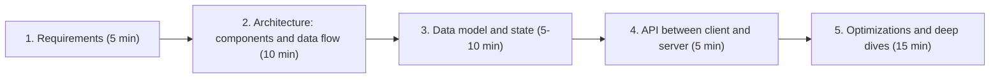

# Front-End System Design: How the Round Works

Front-end design interviews look like backend ones on the surface, but the "system" is the client: components, state, data fetching, rendering performance, accessibility and offline behaviour. The backend is usually a given API that you're allowed to shape.

---

## A five-step structure

| Step | What to cover |
|---|---|
| Requirements | Core features, devices (mobile, desktop), offline, real-time, accessibility, i18n, scale of data (100 rows or 100K) |
| Architecture | Component tree, where data is fetched, how updates flow (server -> cache -> components) |
| Data model | Server state vs client state, normalized cache shape, what lives in the URL |
| API | Endpoints or GraphQL queries, pagination (cursor), real-time channel (WebSocket/SSE), error format |
| Optimizations | Rendering (virtualization, memoization), network (caching, prefetch, batching), perceived speed (skeletons, optimistic UI), accessibility, security (XSS) |

---

## Topics that come up in almost every front-end problem

| Topic | Typical answer |
|---|---|
| Long lists | Virtualize: render only visible rows plus a buffer |
| Out-of-order responses | Abort stale requests (AbortController) or ignore responses for old inputs |
| Feeling fast | Optimistic updates, skeleton screens, prefetch on hover/viewport |
| Real-time | One WebSocket or SSE connection; updates patch the query cache |
| Offline | Queue mutations in IndexedDB, retry with idempotency keys, show sync state |
| Accessibility | Semantic HTML, ARIA roles, keyboard navigation, focus management, screen reader announcements |
| Images | Responsive sizes, lazy loading below the fold, reserved dimensions |
| Security | Escape user content (XSS), CSP, no secrets in the client, CSRF protection |
| Testing | Unit tests for state logic, integration tests for flows, visual regression |

See also: [Front-end performance](../01-fundamentals/33-front-end-performance.md) and [Front-end state](../01-fundamentals/34-front-end-state.md).

---

## Problems in this section
| # | Problem | Main ideas |
|---|---|---|
| 01 | [Autocomplete component](01-autocomplete-component.md) | Debounce, race conditions, caching, ARIA combobox |
| 02 | [Chat app (front end)](02-chat-app-ui.md) | Virtualized list pinned to bottom, optimistic sends, gap filling, one socket for all tabs |
| 03 | [ChatGPT-style assistant UI](03-chatgpt-ui.md) | Token streaming, stop, branches, markdown rendering |
| 04 | [Data table](04-data-table.md) | Virtualized rows and columns, sorting/filtering 100K rows, inline editing |
| 05 | [Collaborative document editor (front end)](05-docs-editor-ui.md) | Document model behind contenteditable, CRDT/OT, remote cursors, offline |
| 06 | [E-commerce site (front end)](06-ecommerce-ui.md) | SSR/SSG for SEO and CDN, cart state, safe checkout |
| 07 | [Image carousel](07-image-carousel.md) | Fast first image, preload neighbours, swipe and keyboard, accessibility |
| 08 | [Kanban board](08-kanban-board.md) | Drag and drop, fractional ordering, optimistic moves, live updates |
| 09 | [News feed (front end)](09-news-feed-ui.md) | Infinite scroll, mixed media, optimistic likes, new-posts banner |
| 10 | [Photo sharing app (front end)](10-photo-sharing-ui.md) | Gallery grid, lazy images, full-screen viewer, resumable uploads |
| 11 | [Spreadsheet (front end)](11-spreadsheet-ui.md) | Canvas/virtualized grid, formula dependency graph, collaboration |
| 12 | [Video streaming site (front end)](12-video-streaming-ui.md) | Adaptive playback (MSE), fast start, browse rows, prefetch |
