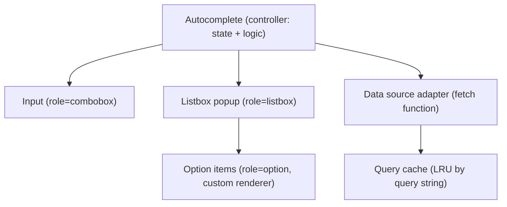
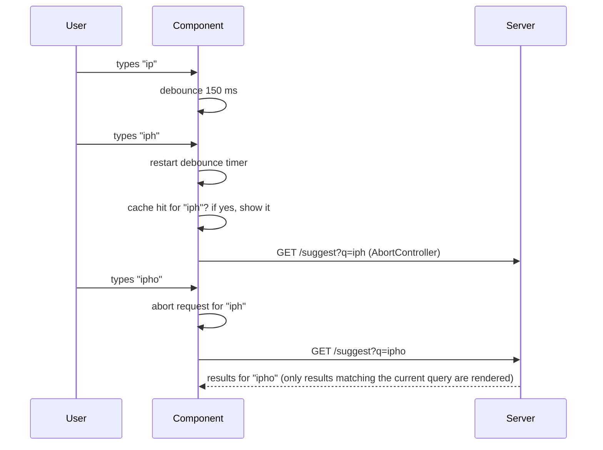

# FE 01 · Autocomplete Component

| Difficulty | Key ideas |
|---|---|
| Medium | debounce, cancel stale requests, response cache, keyboard navigation, ARIA combobox, reusable API |

## Requirements
- A reusable search input that shows suggestions as the user types (products, people, places).
- Suggestions keep up with typing and **never show results for an older query**.
- Works with mouse, keyboard (arrows, Enter, Escape) and screen readers.
- Configurable: data source (remote or local), min characters, max results, custom item rendering.

## Component architecture


## State
```js
{
  query: "iph",
  results: [{ id, label, ... }],
  status: "idle" | "loading" | "success" | "error",
  highlightedIndex: -1,
  isOpen: false
}
```

## Request flow (no stale results)


## API
```
GET /suggest?q=ipho&limit=8  ->  { query: "ipho", items: [{ id, label, type, thumbnail }] }
```
Returning the `query` lets the client ignore any response that doesn't match the current input.

## Optimizations
- **Debounce** (100-200 ms) to cut requests; **min length** (2 chars).
- **Cache** results per query (LRU, a few minutes); prefix filtering of cached results for instant feedback.
- **Abort** in-flight requests when the query changes.
- Highlight the matched part of each label.
- Server-side: results are cached at the CDN for popular prefixes.

## Accessibility
- Input: `role="combobox"`, `aria-expanded`, `aria-controls`, `aria-activedescendant` pointing to the highlighted option.
- Options: `role="option"`, `aria-selected`.
- Announce result counts with an `aria-live="polite"` region.
- Keys: Up/Down move highlight, Enter selects, Escape closes, Tab leaves.

## Interview Q&A

**Q: Results for "ip" arrive after results for "iph". How do you avoid showing them?**
A: Abort the older request and compare the response's query with the current input before rendering.

**Q: How do you make it reusable?**
A: Separate logic (a hook or controller) from rendering; accept a `fetchSuggestions(query, signal)` function and a `renderItem` prop.

**Related:** [Search autocomplete (backend)](../03-problems/10-search-autocomplete.md) · [Front-end state](../01-fundamentals/34-front-end-state.md)
