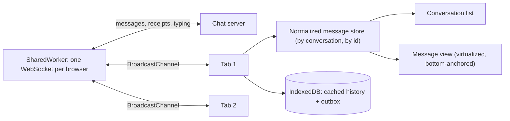
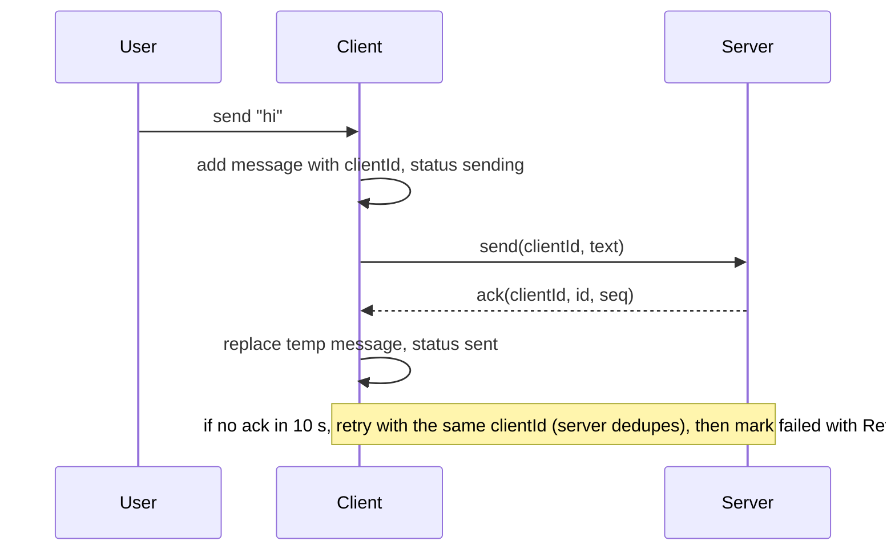

# FE 02 · Chat App (front end)

| Difficulty | Key ideas |
|---|---|
| Medium | virtualized list pinned to the bottom, optimistic sends with client IDs, gap filling after reconnect, one WebSocket shared across tabs, offline queue |

## Requirements
- Conversation list and a message view per conversation.
- Send text and images; see delivery and read status.
- New messages appear instantly; history loads when scrolling up.
- Works across several open tabs and after network drops.

## Architecture


## Data model
```js
conversations: { [convId]: { id, title, lastMessageId, unread } }
messages:      { [convId]: { byId: {...}, order: [msgId...], oldestLoaded, newestSeq } }
message:       { id, clientId, convId, senderId, text, seq, status: "sending"|"sent"|"delivered"|"read"|"failed", createdAt }
```
Messages are keyed by the server sequence number per conversation so ordering and gaps are easy to detect.

## Sending (optimistic)


## Gap filling
On reconnect, send the last known `seq` per open conversation; the server returns missed messages. If an incoming message's `seq` jumps (got 105 after 101), fetch 102-104 before rendering.

## Rendering
- **Virtualized list** with variable heights (measure after render, cache heights).
- **Pinned to bottom:** if the user is at the bottom, new messages keep it there; if they scrolled up, show a "new messages" chip instead of jumping.
- Loading older history at the top must keep the scroll position stable (adjust scrollTop by the height added).
- Group consecutive messages from the same sender; lazy-load images with reserved sizes.

## Offline
Outbox in IndexedDB; flush when back online; show clock icons on pending messages.

## Interview Q&A

**Q: Why one socket for all tabs?**
A: Fewer server connections and consistent state; tabs talk to a SharedWorker (or elect a leader tab) via BroadcastChannel.

**Q: How do you avoid duplicate messages after a retry?**
A: The client ID makes sends idempotent on the server, and the client replaces its temp message when the ack arrives.

**Related:** [Chat system (backend)](../03-problems/09-chat-system.md) · [Front-end state](../01-fundamentals/34-front-end-state.md)
