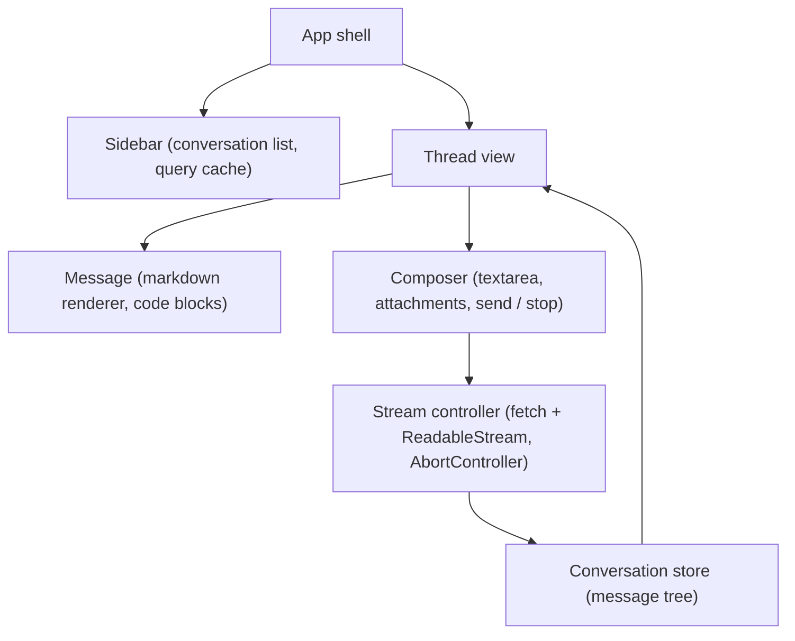
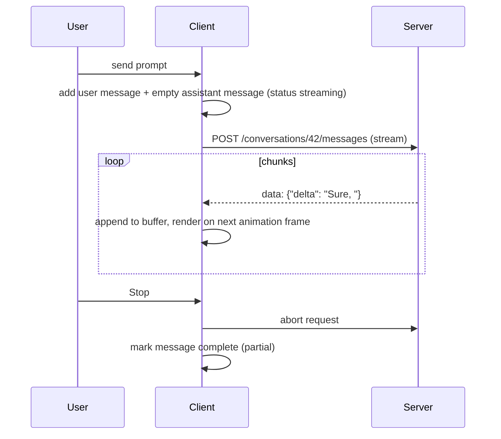

# FE 03 · Chat Assistant UI (ChatGPT front end)

| Difficulty | Key ideas |
|---|---|
| Medium | streaming tokens over SSE/fetch streams, incremental markdown rendering, stop generation, conversation branches as a tree, file uploads, auto-scroll that respects the user |

## Requirements
- Sidebar of conversations; main thread of messages.
- Model replies **stream** token by token; user can **stop** at any time.
- Edit an earlier message or regenerate a reply, creating **branches** the user can switch between.
- Markdown, code blocks with syntax highlighting and copy button.
- Attach files and images.

## Architecture


## Data model: conversations are trees
```js
messages: {
  m1: { id: "m1", role: "user", content: "...", parentId: null, childrenIds: ["m2"] },
  m2: { id: "m2", role: "assistant", content: "...", parentId: "m1", childrenIds: ["m3", "m5"] },
}
currentLeafId: "m5"   // the visible path is the chain of parents from this leaf
```
Editing message m3 creates a sibling m5 under the same parent; arrows "2 / 2" switch between siblings.

## Streaming flow


## Rendering streamed markdown
- Append text to a buffer and re-render at most once per animation frame (not per token).
- Parse markdown incrementally; tolerate unfinished code fences until they close.
- Sanitize rendered HTML (model output is untrusted) to avoid XSS.
- **Auto-scroll** only while the user is at the bottom; if they scroll up to read, stop following.

## Other details
- File uploads go first (pre-signed URL), then the message references file IDs.
- Persist drafts per conversation in local storage.
- Show retry on network errors; resume isn't always possible, so regenerate.
- Keyboard: Enter to send, Shift+Enter for new line; focus returns to the composer.

## Interview Q&A

**Q: Why render once per animation frame instead of per token?**
A: Tokens can arrive faster than the screen refreshes; batching keeps the main thread free and typing in the composer smooth.

**Q: How do you model regenerate and edit?**
A: Store messages as a tree with parent pointers; the visible thread is the path to the selected leaf.

**Related:** [LLM chat service (backend)](../03-problems/45-llm-chat-service.md) · [Front-end performance](../01-fundamentals/33-front-end-performance.md)
