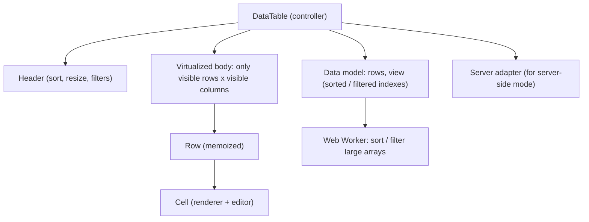
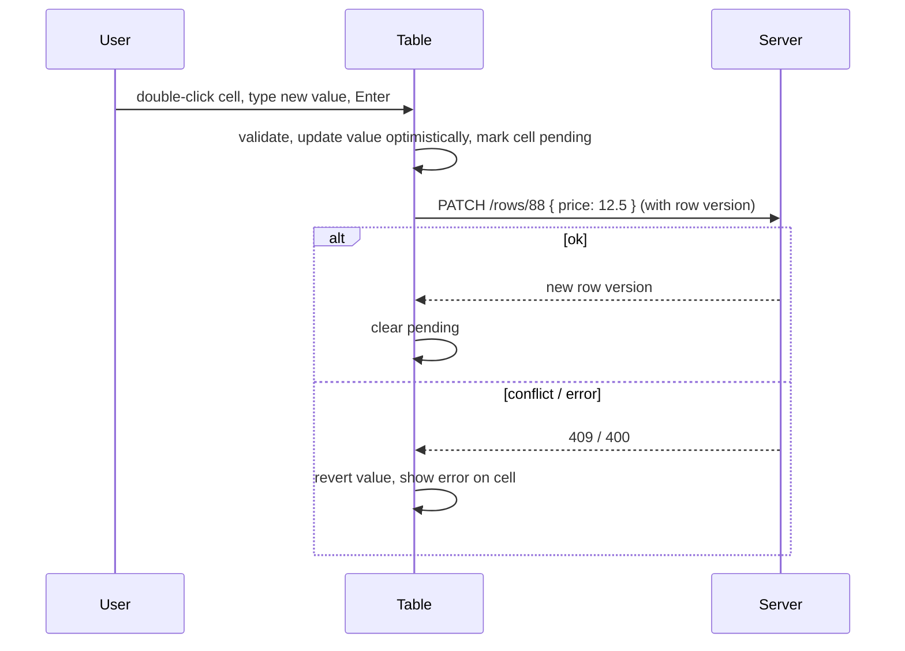

# FE 04 · Data Table Component

| Difficulty | Key ideas |
|---|---|
| Medium | row and column virtualization, client vs server sort/filter, Web Worker for heavy work, inline editing with optimistic saves, keyboard grid navigation |

## Requirements
- Show up to 100,000 rows with dozens of columns.
- Sort, filter, resize and reorder columns, pin columns.
- Select rows, edit cells inline, keep scrolling at 60 frames per second.

## Architecture

## Client or server processing?
| Rows | Approach |
|---|---|
| Up to ~100K that fit in memory | Load once; sort/filter on the client (in a Web Worker) |
| Millions | Server-side sort, filter and pagination; client virtualizes the visible window and fetches pages as you scroll |

## Virtualization
- Rows: fixed row height makes math simple (`firstRow = scrollTop / rowHeight`); render visible rows + ~10 overscan.
- Columns: same idea horizontally when there are many columns; pinned columns rendered separately.
- Keep a spacer element with the full height so the scrollbar is correct.

## Keeping 60 fps
- Never re-sort on the main thread for large data; post the data once to a worker and send back an index array.
- Store the **view** as an array of row indexes, not copies of rows.
- Memoize rows; cells re-render only when their value changes.
- Use CSS transforms for positioning; avoid layout thrashing.

## Editing

## Accessibility
`role="grid"`, `aria-rowcount` with the full count (virtual rows aren't in the DOM), `aria-rowindex` on rendered rows, arrow-key navigation between cells, Enter to edit, Escape to cancel.

## Interview Q&A

**Q: Sorting 100K rows freezes the page. Fix?**
A: Sort in a Web Worker on an index array and keep the main thread for scrolling; or move sorting to the server.

**Q: How does a screen reader know there are 100K rows if only 30 are rendered?**
A: Set `aria-rowcount` on the grid and `aria-rowindex` on each rendered row.

**Related:** [Front-end performance](../01-fundamentals/33-front-end-performance.md) · [Spreadsheet](11-spreadsheet-ui.md)
