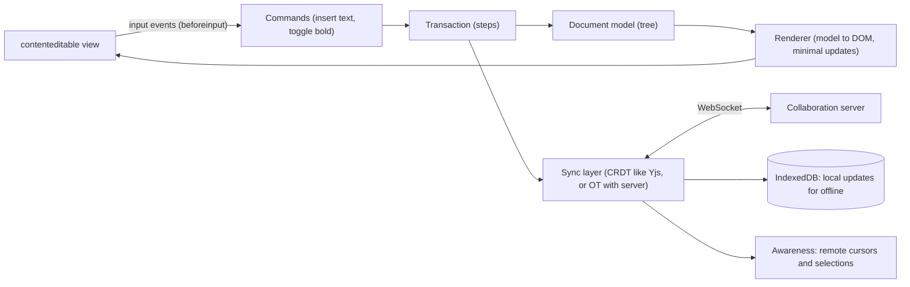
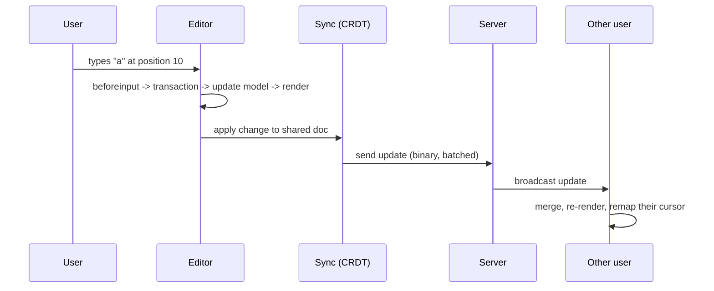

# FE 05 · Collaborative Document Editor (front end)

| Difficulty | Key ideas |
|---|---|
| Hard | own document model behind contenteditable, transactions, CRDT or OT sync, remote cursors mapped through changes, offline edits, undo per user |

## Requirements
- Rich text: headings, lists, bold, links, images, tables.
- Several people edit the same document live and see each other's cursors.
- Offline edits merge when back online.
- Undo/redo of your own changes only.

## Why not just use contenteditable?
Browsers produce inconsistent HTML from contenteditable, and you can't reliably sync DOM changes between users. Instead keep a **structured document model** (a tree of nodes with marks) and treat the DOM as a view of it. Editors like ProseMirror, Lexical and Slate work this way.

## Architecture

## Editing flow

## Key details
- **Positions move:** when remote text is inserted before your cursor, map your selection through the change so it stays on the same character. CRDTs use relative positions anchored to characters, not indexes.
- **Remote cursors:** awareness messages (user, color, selection) are throttled and not persisted.
- **Undo:** track only local transactions; undo produces an inverse change that is synced like any other.
- **Offline:** keep CRDT updates in IndexedDB; on reconnect, exchange state vectors and send only missing updates.
- **IME and mobile keyboards:** handle composition events carefully; don't re-render mid-composition.
- **Large documents:** render only visible blocks; lazy-load images.
- **Paste:** sanitize HTML into model nodes, never insert raw HTML.

## Interview Q&A

**Q: How do two people typing in the same sentence end up with the same text?**
A: Changes go through a CRDT (or the server's OT transform), which merges concurrent inserts deterministically on every client.

**Q: Why keep a separate model?**
A: It gives predictable structure, makes syncing and undo possible, and lets you control rendering instead of relying on browser quirks.

**Related:** [Google Docs (backend)](../03-problems/35-google-docs.md) · [Collaborative whiteboard](../03-problems/75-collaborative-whiteboard.md)
