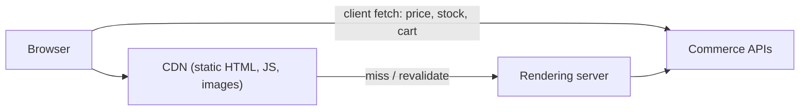
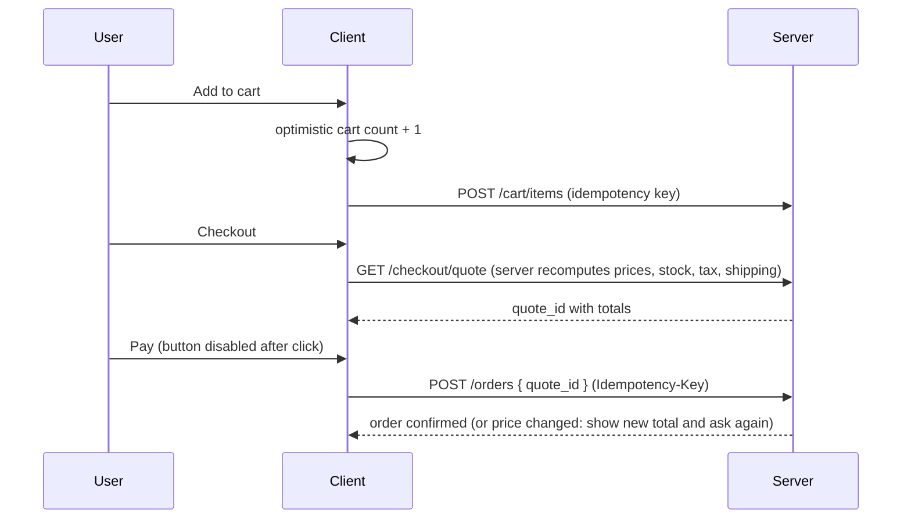

# FE 06 · E-commerce Site (front end)

| Difficulty | Key ideas |
|---|---|
| Medium | SSG/ISR for product and category pages, CDN caching with personalization split out, cart as server state, checkout that never charges a stale price or twice, performance and SEO |

## Requirements
- Home, category listing (filters, sort), product detail, cart, checkout, order confirmation.
- Pages must be indexed by search engines and load fast on phones.
- Price and stock must be correct at checkout; double-clicking "Pay" must not charge twice.

## Rendering strategy per page
| Page | Strategy | Why |
|---|---|---|
| Home, category | Static/ISR, revalidate every few minutes | Same for everyone, CDN cacheable, SEO |
| Product detail | Static/ISR + client fetch for live price and stock | SEO plus fresh data |
| Search results | SSR (or CSR after first load) | Depends on query |
| Cart, checkout, account | CSR behind auth, never cached at CDN | Personal and sensitive |

## Keeping cached pages personal
Serve the same cached HTML to everyone, then load personal pieces (cart count, "recommended for you", logged-in name) on the client. Never put user-specific data in CDN-cached HTML.

## Filters and URL
Filters, sort and page live in the URL (`/shoes?brand=nike&sort=price_asc&page=2`): shareable, back-button friendly, crawlable for important combinations.

## Cart and checkout

- The client never sends prices; the server computes them in a **quote**.
- Disable the Pay button and send an **idempotency key**, so retries or double clicks create one order.
- If price or stock changed since the quote, the server rejects and the UI shows the new total.

## Performance
- Optimize the product image (LCP): responsive sizes, preload, modern formats.
- Code-split checkout and heavy widgets; keep category pages light.
- Prefetch product pages on hover or when cards enter the viewport.

## Interview Q&A

**Q: How do you cache product pages at the CDN if prices change?**
A: Cache the page shell and description; fetch price and stock on the client (or revalidate often), and always confirm at checkout.

**Q: How do you prevent double charges?**
A: Disable the button, send an idempotency key with the order request, and have the server dedupe.

**Related:** [E-commerce (backend)](../03-problems/38-ecommerce-flash-sale.md) · [Front-end performance](../01-fundamentals/33-front-end-performance.md)
