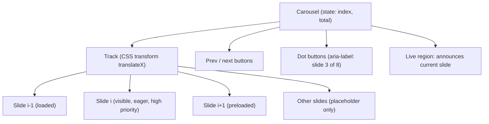

# FE 07 · Image Carousel Component

| Difficulty | Key ideas |
|---|---|
| Easy | fast first image, load only neighbours, swipe + keyboard + buttons, no layout shift, ARIA carousel pattern, reduced motion |

## Requirements
- Show a set of photos one at a time with previous/next, dots, swipe on touch.
- First photo appears fast; others load only when they're about to be shown.
- Optional autoplay that pauses on hover/focus.
- Accessible by keyboard and screen reader.

## Structure


## Loading strategy
- First image: `loading="eager"`, `fetchpriority="high"`, correct `srcset`/`sizes`; it's often the page's LCP element.
- Neighbours (i-1, i+1): preload when the current slide changes.
- Others: render a sized placeholder (blur hash or background color) and load on demand.
- Reserve aspect ratio so nothing shifts while images load.

## Interaction
- Swipe: pointer events, follow the finger with transforms, snap on release based on distance and velocity.
- Keyboard: Left/Right when the carousel has focus; buttons are real `<button>` elements.
- Animations on the GPU (`transform`), not `left`; respect `prefers-reduced-motion`.
- Autoplay pauses on hover, focus, and when the tab is hidden; provide a pause button.

## Accessibility
- Container: `role="region"` with `aria-roledescription="carousel"` and a label.
- Each slide: `role="group"`, `aria-roledescription="slide"`, `aria-label="3 of 8"`.
- Hidden slides not focusable (`inert` or `aria-hidden`), every image has alt text.

## API
```jsx
<Carousel images={[{ src, srcSet, alt, width, height }]} startIndex={0} autoplay={false} onChange={(i) => {}} />
```

## Interview Q&A

**Q: How do you keep a 50-photo carousel light?**
A: Only the current and neighbouring slides load real images; the rest are placeholders until needed.

**Q: How do you avoid layout shift?**
A: Give every slide a fixed aspect ratio from known image dimensions.

**Related:** [Front-end performance](../01-fundamentals/33-front-end-performance.md) · [Photo sharing UI](10-photo-sharing-ui.md)
