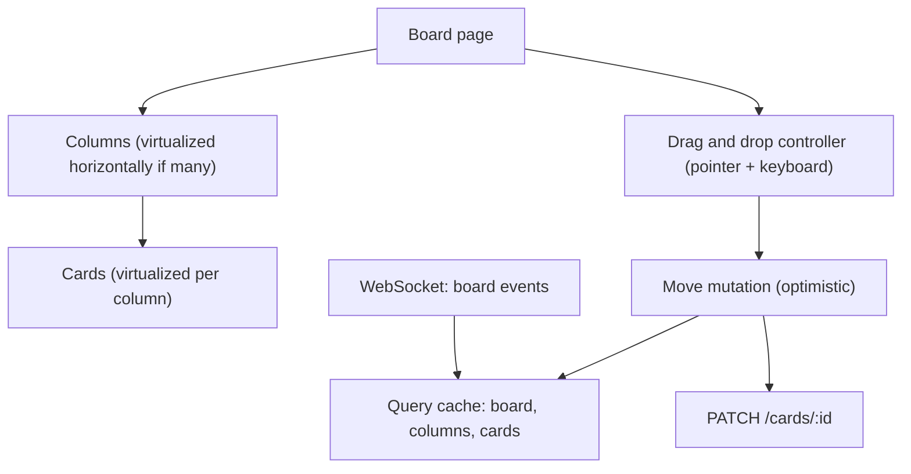
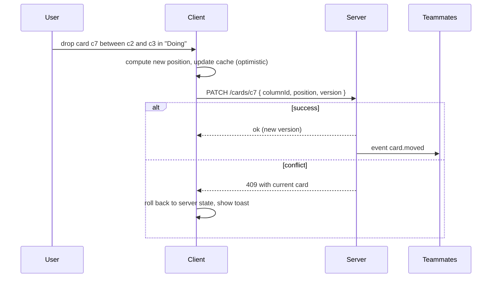

# FE 08 · Kanban Board (Trello / Jira)

| Difficulty | Key ideas |
|---|---|
| Medium | drag and drop with keyboard support, fractional indexes for ordering, optimistic moves with rollback, live updates from teammates, conflict handling |

## Requirements
- Board with columns (lists) and cards; drag cards within and across columns, reorder columns.
- Edit cards, add comments, assign people.
- Teammates' changes appear live.
- Smooth with hundreds of cards.

## Architecture


## Ordering with fractional indexes
Store a `position` string or number per card. To move a card between positions 1.0 and 2.0, give it 1.5. Only the moved card changes, so concurrent moves by different people rarely conflict. Periodically rebalance if numbers get too long (string-based fractional indexing avoids precision limits).

```js
cards: { c7: { id: "c7", columnId: "todo", position: "a1V", title, version } }
```

## Moving a card


## Live updates
Events (card created/moved/updated) patch the query cache. Ignore your own events (by client mutation ID) to avoid double-applying. While the user is dragging, queue incoming updates and apply them after drop so the board doesn't jump under the cursor.

## Accessibility
Drag and drop must also work by keyboard: focus a card, press Space to pick up, arrows to move, Space to drop, Escape to cancel, with live-region announcements ("Card moved to Doing, position 3 of 5").

## Interview Q&A

**Q: Why fractional positions instead of integer indexes?**
A: Inserting between two cards updates just one record instead of renumbering the whole column.

**Q: Two people move the same card at once. What happens?**
A: Version check on the server: the second write gets a conflict, its client rolls back to the server's state.

**Related:** [Front-end state](../01-fundamentals/34-front-end-state.md) · [Collaborative whiteboard](../03-problems/75-collaborative-whiteboard.md)
