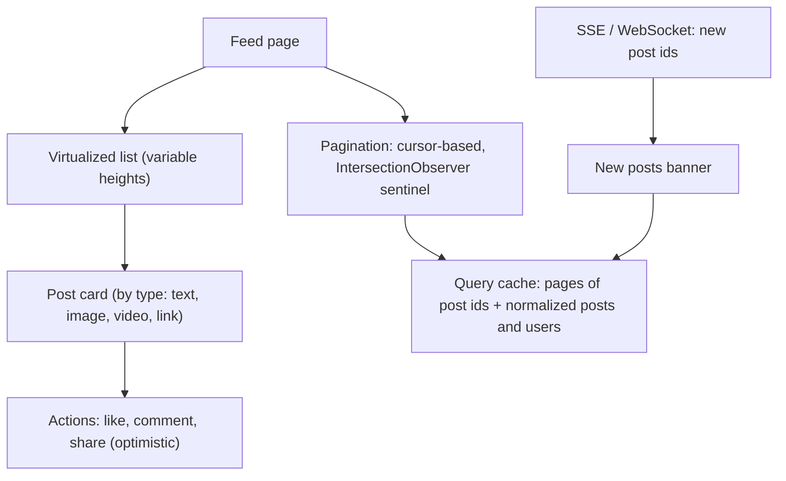
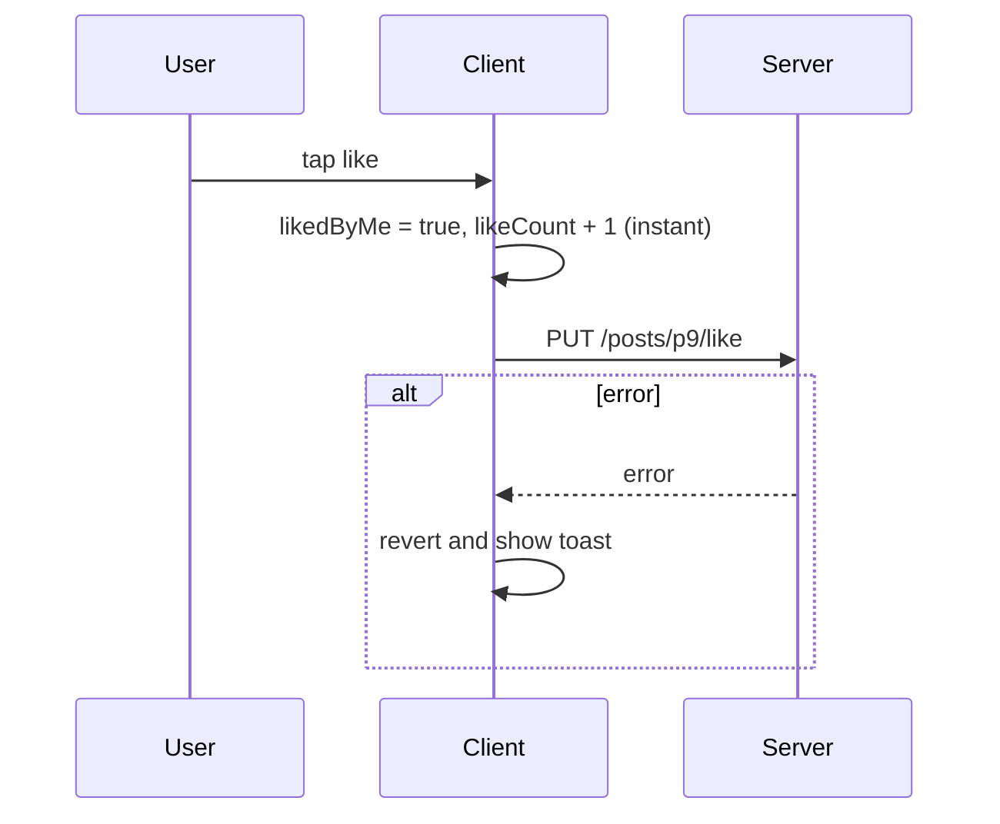

# FE 09 · News Feed (front end)

| Difficulty | Key ideas |
|---|---|
| Medium | cursor-based infinite scroll, virtualization with variable heights, normalized cache, optimistic likes, "new posts" banner instead of jumping, media lazy loading |

## Requirements
- Infinite scrolling feed of mixed posts: text, images, videos, links.
- Like, comment, share with instant feedback.
- New posts arrive while reading without moving the content under the user.
- Smooth on mid-range phones.

## Architecture


## Data shape
```js
feedPages: [{ items: ["p9", "p8", ...], nextCursor: "eyJ0IjoxNzM..." }]
posts: { p9: { id, authorId, type, text, media, likeCount, likedByMe } }
users: { u3: { id, name, avatar } }
```
Normalized posts mean a like updates one object and every place it appears re-renders.

## Infinite scroll
- Load the next page when a sentinel near the bottom enters the viewport (IntersectionObserver), not on every scroll event.
- Cursor pagination so new posts at the top don't shift pages.
- Virtualize: keep only nearby posts in the DOM; cache measured heights; restore scroll position on back navigation.

## New posts
Don't insert them at the top while the user is reading. Show a "5 new posts" banner; clicking it prepends them and scrolls to top.

## Optimistic like

Use PUT/DELETE (idempotent) rather than a toggle endpoint so rapid taps and retries end in the right state.

## Media
- Images: responsive `srcset`, lazy loading, reserved aspect ratio, blur placeholders.
- Videos: autoplay muted only when mostly visible, pause when scrolled away, load poster first.

## Interview Q&A

**Q: Why cursor and not page numbers?**
A: New posts arriving would shift page boundaries and cause duplicates or gaps.

**Q: How do you keep memory stable after scrolling 1,000 posts?**
A: Virtualization keeps a constant number of DOM nodes; evict old pages of media from memory.

**Related:** [News feed (backend)](../03-problems/08-news-feed-system.md) · [Front-end state](../01-fundamentals/34-front-end-state.md)
