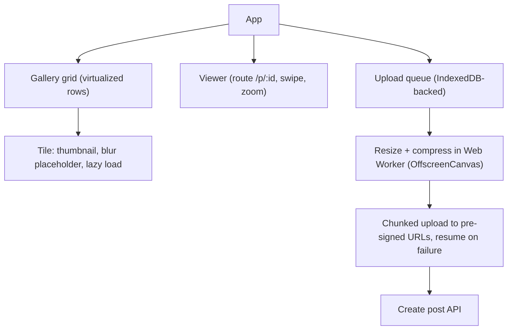
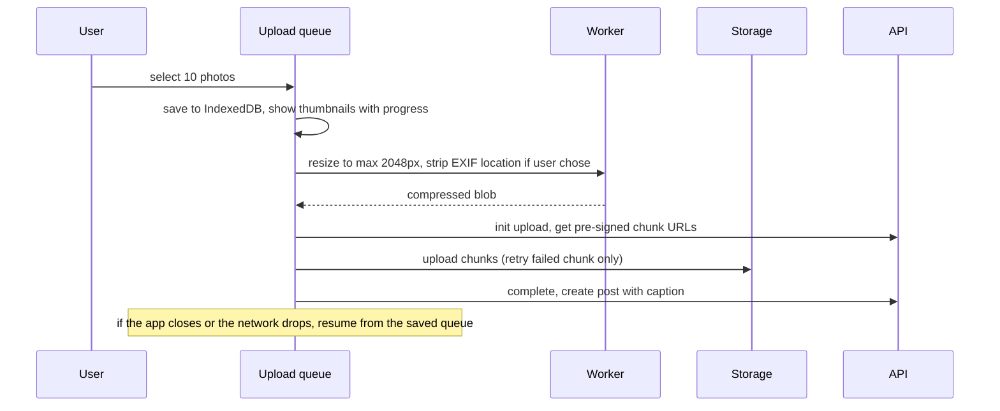

# FE 10 · Photo Sharing App (front end)

| Difficulty | Key ideas |
|---|---|
| Medium | responsive gallery grid, lazy loading with placeholders, full-screen viewer with URL state, client-side resize before upload, resumable chunked uploads with an upload queue |

## Requirements
- Feed and profile **gallery grid** of photos.
- Tap a photo to open a **full-screen viewer** with swipe between photos.
- **Upload** one or many photos that survive flaky mobile networks.
- Fast on phones with slow connections.

## Architecture

## Grid performance
- Request thumbnails sized for the tile (for example 320px wide), not full images.
- `loading="lazy"` for tiles below the fold, plus a tiny blur hash or dominant color placeholder.
- Reserve each tile's aspect ratio; virtualize rows for large libraries.
- Prefetch the viewer's full-size image when the user hovers or presses on a tile.

## Viewer
- Its own URL (`/p/123`) so it can be shared and closed with the back button; opened over the grid as a modal route.
- Load a medium size first, then high resolution; preload the next and previous photos.
- Pinch-zoom and swipe with transforms; focus trap and Escape to close.

## Upload flow

## Interview Q&A

**Q: Why resize on the device?**
A: Phone photos can be 5-10 MB; resizing first cuts upload time and data usage dramatically.

**Q: How does an upload survive the app being closed?**
A: The queue and file blobs live in IndexedDB, chunks are tracked, and the upload resumes from the last completed chunk (a Service Worker with Background Sync can help).

**Related:** [Instagram (backend)](../03-problems/27-instagram.md) · [Image carousel](07-image-carousel.md) · [Front-end performance](../01-fundamentals/33-front-end-performance.md)
