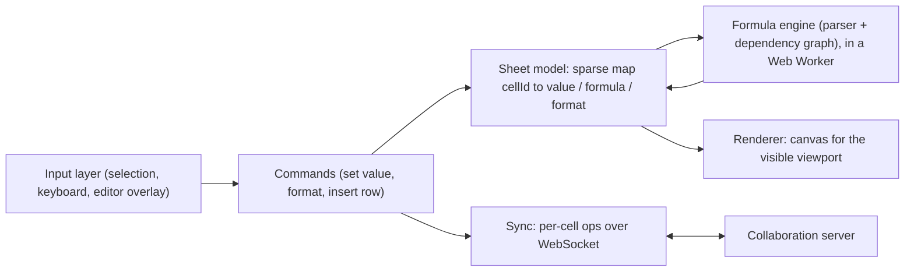
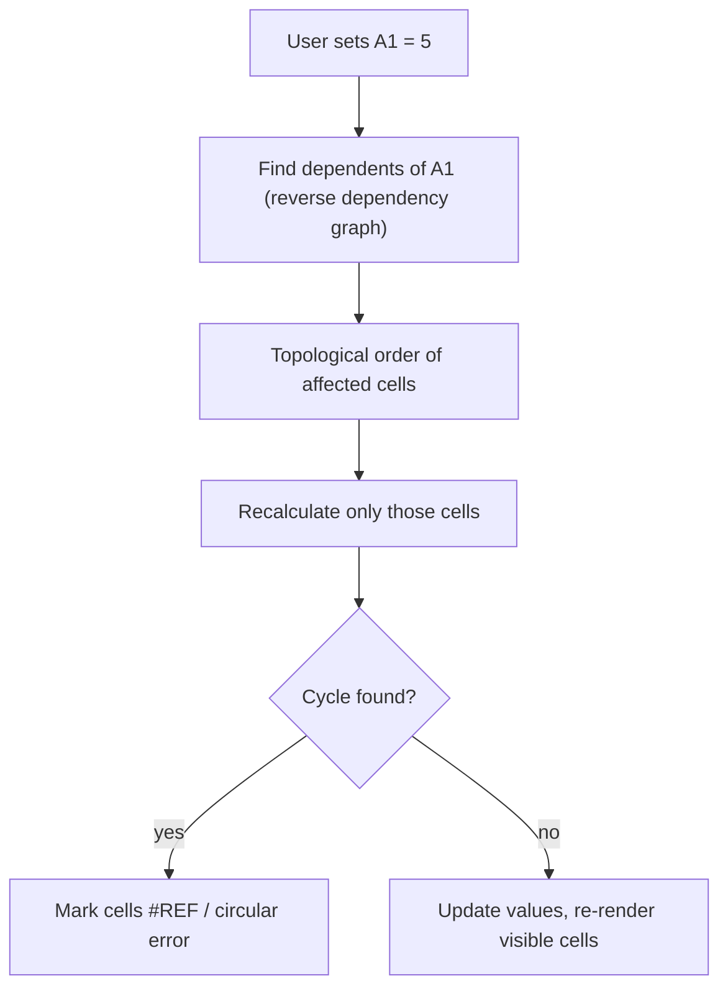

# FE 11 · Spreadsheet (Google Sheets front end)

| Difficulty | Key ideas |
|---|---|
| Hard | sparse cell storage, canvas or virtualized grid rendering, formula parser and dependency graph with incremental recalculation, cycle detection, collaboration with per-cell ops |

## Requirements
- Grid of up to millions of cells (most empty), smooth scrolling.
- Formulas (`=SUM(A1:A10)`, references across cells), recalculation on change.
- Formatting, column resize, copy/paste, undo.
- Live collaboration with other users' selections.

## Architecture

## Data model
- **Sparse storage:** `Map("R12C3" -> { raw: "=A1*2", value: 84, format })`; empty cells take no memory.
- Row heights and column widths in arrays with prefix sums for fast pixel-to-cell lookup.

## Formula engine

- Parse formulas into an AST once; store which cells each formula reads (edges).
- On change, recalculate only the cells that depend on it, in topological order.
- Run in a Web Worker so big recalculations don't freeze scrolling.

## Rendering
Millions of DOM nodes are impossible. Draw the visible viewport on a **canvas** (or a virtualized DOM grid), and place a real `<input>` overlay over the cell being edited. Redraw only changed regions.

## Collaboration
- Operations are per cell (`set A1`, `format B2:B9`) so concurrent edits to different cells never conflict; same-cell edits use last-writer-wins by server order.
- Structural changes (insert row) shift references; formulas must be rewritten (an OT-style transform on cell references).
- Remote selections drawn as colored borders.

## Interview Q&A

**Q: Why not recalculate the whole sheet on every edit?**
A: Large sheets have hundreds of thousands of formulas; recalculating only dependents keeps edits instant.

**Q: How do you handle inserting a row while someone else edits a formula below it?**
A: Treat row insertion as an operation that shifts references, and transform concurrent operations (and formulas) through it.

**Related:** [Data table](04-data-table.md) · [Google Docs (backend)](../03-problems/35-google-docs.md)
