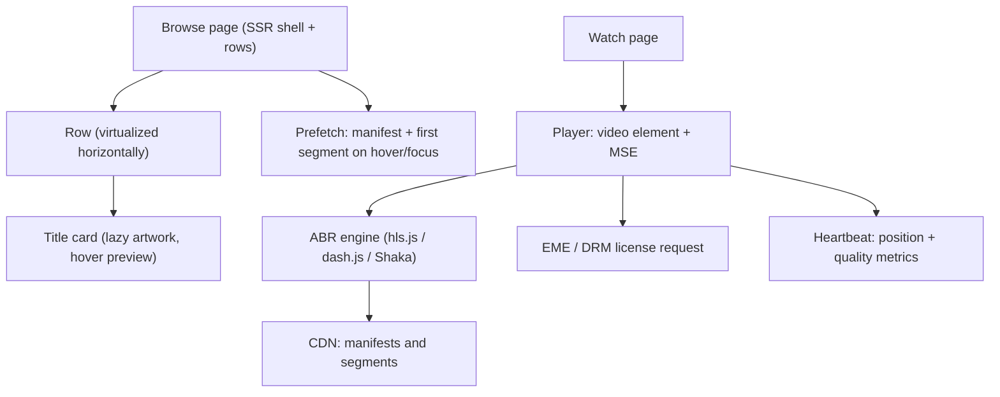
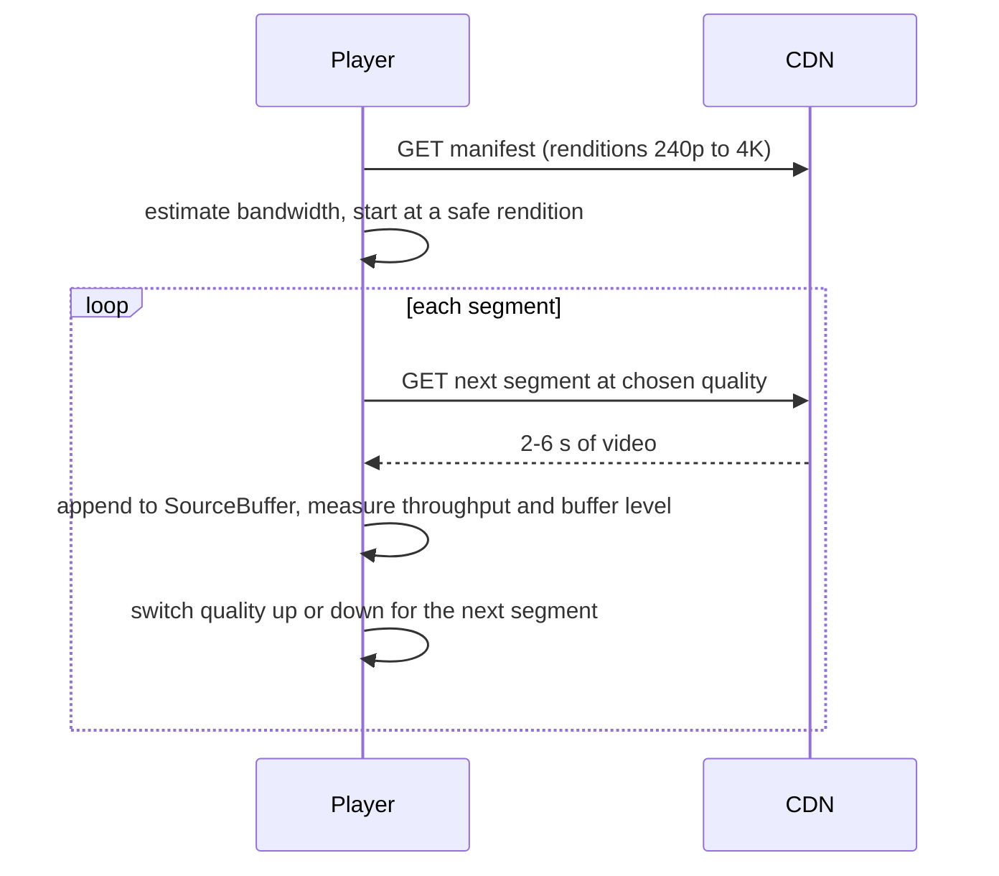

# FE 12 · Video Streaming Site (front end)

| Difficulty | Key ideas |
|---|---|
| Medium | adaptive playback with Media Source Extensions (hls.js / dash.js / Shaka), fast start, browse rows with lazy loading and prefetch, resume position, accessible player |

## Requirements
- Browse page with rows of titles (horizontal scroll), title detail pages, watch page.
- Playback starts quickly and adapts to network speed without stalling.
- Resume where you left off, subtitles, keyboard shortcuts.

## Architecture

## How adaptive playback works in the browser

## Fast start
- Preconnect to the CDN; prefetch the manifest and first segment when the user hovers or focuses a title.
- Start with a lower rendition and step up once the buffer is healthy.
- Show the poster frame instantly; keep the player's JavaScript small (load it lazily on the browse page).

## Browse page
- Rows load artwork lazily as they enter the viewport; horizontal virtualization for long rows.
- Keyboard and TV-remote navigation with clear focus states (spatial navigation).
- Personalized rows fetched in parallel; skeletons while loading.

## Player details
- Resume position from the server (sent by heartbeats every ~10 s).
- Subtitles (WebVTT) with styling options; audio track selection.
- Keyboard: Space play/pause, arrows seek, F fullscreen, M mute; captions toggle reachable by keyboard and screen reader.
- QoE metrics: startup time, rebuffer count, bitrate switches, errors.

## Interview Q&A

**Q: How does the browser switch quality mid-video?**
A: Media Source Extensions let JavaScript feed segments into the video element; the ABR logic picks each next segment's rendition based on measured bandwidth and buffer.

**Q: How do you make "play" feel instant?**
A: Prefetch the manifest and first segment on hover, start at a low rendition, and keep the poster visible until the first frame decodes.

**Related:** [Netflix (backend)](../03-problems/46-netflix.md) · [YouTube](../03-problems/11-youtube.md) · [Front-end performance](../01-fundamentals/33-front-end-performance.md)
