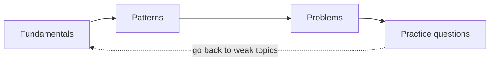

# System Design Notes

Notes I use to prepare for system design interviews: the core concepts, reusable patterns, 68 worked problems, a low-level design section, and a bank of practice questions with answers.

Every problem uses the same layout so it is quick to revise:

**Summary, requirements, estimates, API, architecture diagram, key flows, deep dives, trade-offs, failure handling, interview Q&A.**

Diagrams are written in [Mermaid](https://mermaid.js.org/), so GitHub renders them directly on the page.

---

## Contents

| Folder | What is inside |
|---|---|
| [01-fundamentals](01-fundamentals/) | 35 notes on the concepts every design builds on |
| [02-patterns](02-patterns/README.md) | 24 reusable design patterns, each with a diagram and examples |
| [03-problems](03-problems/) | 68 high-level design problems, worked end to end |
| [04-interview-questions](04-interview-questions/) | Concept Q&A, scenario questions, estimation drills, quick designs |
| [05-low-level-design](05-low-level-design/) | OOP, SOLID, design patterns and 7 class-design problems with code |

---

## Study plan (4 weeks)

| Week | Focus | Material |
|---|---|---|
| 1 | Foundations | Fundamentals 28 (clients and servers), 21-23 (scaling, estimation, interview framework), then 01-08 |
| 2 | Distributed systems | Fundamentals 09-20, 24-27 and 29-32 (back-pressure, failover, multi-region, trade-offs), the [patterns](02-patterns/README.md) page |
| 3 | Classic problems | URL shortener, rate limiter, news feed, chat, YouTube, Google Drive, Uber, Ticketmaster, payments |
| 4 | Breadth and mocks | Remaining problems by category, [scenario questions](04-interview-questions/02-scenario-questions.md), timed 45-minute mocks |

Front-end rounds: add fundamentals 33-34 (front-end performance and state).

Short on time: read the [cheat sheet](01-fundamentals/00-interview-cheat-sheet-and-problem-patterns.md), the [framework](01-fundamentals/23-interview-framework.md) and the [patterns](02-patterns/README.md), then pick problems from your target company's domain.

---

## 1. Fundamentals

- [System Design Interview Cheat Sheet & Problem Patterns](01-fundamentals/00-interview-cheat-sheet-and-problem-patterns.md)
- [Networking Basics for System Design](01-fundamentals/01-networking-basics.md)
- [API Design (REST, GraphQL, gRPC & Best Practices)](01-fundamentals/02-api-design.md)
- [Load Balancing](01-fundamentals/03-load-balancing.md)
- [Databases: SQL vs NoSQL, ACID, Isolation & Indexing](01-fundamentals/04-databases-sql-vs-nosql-acid-indexing.md)
- [Replication](01-fundamentals/05-replication.md)
- [Partitioning (Sharding)](01-fundamentals/06-partitioning-and-sharding.md)
- [Caching Deep Dive](01-fundamentals/07-caching-deep-dive.md)
- [CAP Theorem, PACELC & Consistency Models](01-fundamentals/08-cap-pacelc-and-consistency-models.md)
- [Consensus, Leader Election & Distributed Locks](01-fundamentals/09-consensus-leader-election-and-distributed-locks.md)
- [Distributed Transactions: 2PC, Saga, Outbox & CDC](01-fundamentals/10-distributed-transactions-2pc-saga-outbox.md)
- [Message Queues, Pub/Sub & Event Streaming](01-fundamentals/11-message-queues-pub-sub-and-event-streaming.md)
- [Architecture Patterns: Monolith, Microservices, CQRS, Event Sourcing & more](01-fundamentals/12-architecture-patterns-microservices-cqrs-event-sourcing.md)
- [Reliability & Resilience Patterns](01-fundamentals/13-reliability-and-resilience-patterns.md)
- [Observability: Logs, Metrics & Traces](01-fundamentals/14-observability-logs-metrics-tracing.md)
- [Security in System Design](01-fundamentals/15-security-authn-authz-encryption.md)
- [Storage Systems: Block, File, Object, Data Lakes & Warehouses](01-fundamentals/16-storage-systems-block-file-object-oltp-vs-olap.md)
- [Batch & Stream Processing](01-fundamentals/17-batch-and-stream-processing.md)
- [Probabilistic Data Structures and Useful Algorithms](01-fundamentals/18-probabilistic-data-structures-and-useful-algorithms.md)
- [Search Systems & the Inverted Index](01-fundamentals/19-search-systems-and-inverted-index.md)
- [Time, Clocks & Ordering in Distributed Systems](01-fundamentals/20-time-clocks-and-ordering.md)
- [Scaling from Zero to Millions of Users](01-fundamentals/21-scaling-from-zero-to-millions.md)
- [Back-of-the-Envelope Estimation](01-fundamentals/22-back-of-the-envelope-estimation.md)
- [The System Design Interview Framework](01-fundamentals/23-interview-framework.md)
- [Containers, Kubernetes and Deployment Infrastructure](01-fundamentals/24-containers-kubernetes-and-deployment.md)
- [Serialization Formats and Schema Evolution](01-fundamentals/25-serialization-and-schema-evolution.md)
- [Concurrency Models and Connection Handling](01-fundamentals/26-concurrency-and-connection-handling.md)
- [Multi-Tenancy and Data Modeling](01-fundamentals/27-multi-tenancy-and-data-modeling.md)
- [Clients and Servers](01-fundamentals/28-client-server-basics.md)
- [Back-Pressure](01-fundamentals/29-back-pressure.md)
- [Availability and Failover](01-fundamentals/30-availability-and-failover.md)
- [Multi-Region Design](01-fundamentals/31-multi-region-design.md)
- [Making and Defending Trade-offs](01-fundamentals/32-making-trade-offs.md)
- [Front-End Performance](01-fundamentals/33-front-end-performance.md)
- [Front-End State](01-fundamentals/34-front-end-state.md)

---

## 2. Patterns

[All 24 patterns](02-patterns/README.md): cache-aside, fan-out, queue and workers, pre-signed uploads, transactional outbox, saga, idempotency keys, holds with expiry, conditional updates, waiting rooms, sharded counters, windowed aggregation, geo cells, pub/sub fan-out, two-stage ranking, CQRS, event sourcing, leader election with fencing, scatter-gather, circuit breakers, rate limiting, LSM storage, consistent hashing, cell-based architecture.

---

## 3. Problems

### Building blocks and infrastructure

| # | Problem | Difficulty | Key ideas |
|---|---|---|---|
| 01 | [Rate Limiter](03-problems/01-rate-limiter.md) | Medium | token bucket, sliding window, atomic counters in Redis, API gateway middleware |
| 02 | [Consistent Hashing](03-problems/02-consistent-hashing.md) | Medium | hash ring, virtual nodes, minimal data movement |
| 03 | [Distributed Key-Value Store (Dynamo / Cassandra style)](03-problems/03-key-value-store.md) | Hard | consistent hashing, replication, quorum, vector clocks, gossip, hinted handoff, Merkle trees, LSM tree |
| 04 | [Unique ID Generator for Distributed Systems](03-problems/04-unique-id-generator.md) | Easy | Snowflake IDs, coordination-free generation, clock handling |
| 16 | [Distributed Message Queue (Kafka-like)](03-problems/16-distributed-message-queue.md) | Very hard | partitioned append-only logs, segment files, leader/follower replication with ISR, consumer groups & offsets, batching |
| 21 | [S3-like Object Storage](03-problems/21-object-storage-s3.md) | Very hard | metadata/data separation, immutable objects, append-only data files, replication vs erasure coding, checksums, placement service |
| 31 | [Distributed Cache (Redis / Memcached)](03-problems/31-distributed-cache.md) | Hard | hash map + LRU, TTL expiry, hash slots, async replication, failover, hot-key mitigation |
| 44 | [Distributed Lock Service (Chubby / ZooKeeper)](03-problems/44-distributed-lock-service.md) | Hard | Raft replication, sessions & leases, fencing tokens, ephemeral sequential nodes |
| 52 | [Content Delivery Network (CDN)](03-problems/52-cdn.md) | Hard | anycast / GeoDNS routing, tiered caching, consistent hashing inside a PoP, request coalescing, purge propagation |
| 59 | [Domain Name System (DNS)](03-problems/59-dns.md) | Medium | hierarchical delegation, caching with TTL, anycast, replication of authoritative zones, eventual consistency |
| 61 | [Distributed File System (GFS / HDFS)](03-problems/61-distributed-file-system.md) | Hard | single metadata master, large chunks, chunk replication, leases, pipelined writes, rack awareness |
| 63 | [API Gateway](03-problems/63-api-gateway.md) | Medium | request pipeline of filters, route table, auth offload, rate limiting, config push, stateless data plane |

### Read-heavy lookups

| # | Problem | Difficulty | Key ideas |
|---|---|---|---|
| 05 | [URL Shortener (TinyURL / bit.ly)](03-problems/05-url-shortener.md) | Easy | unique key generation, Base62, cache-aside, 301 vs 302, analytics via events |
| 33 | [Pastebin](03-problems/33-pastebin.md) | Easy | key generation service, metadata vs blob separation, expiry, caching |
| 10 | [Search Autocomplete (Typeahead)](03-problems/10-search-autocomplete.md) | Medium | trie with cached top-K, offline aggregation pipeline, sharding by prefix, client debouncing & caching |

### Social, feeds and ranking

| # | Problem | Difficulty | Key ideas |
|---|---|---|---|
| 08 | [News Feed System (Facebook / LinkedIn feed)](03-problems/08-news-feed-system.md) | Medium | fan-out on write vs read, hybrid for celebrities, ID-only feed cache, multi-layer caching, cursor pagination |
| 26 | [Twitter (X)](03-problems/26-twitter.md) | Hard | hybrid fan-out, timeline cache, Snowflake IDs, trends via stream processing |
| 27 | [Instagram](03-problems/27-instagram.md) | Hard | pre-signed uploads, async media pipeline, CDN, ranked feed, TTL stories |
| 49 | [Reddit (Communities, Voting, Nested Comments)](03-problems/49-reddit.md) | Medium | vote counters, time-decay ranking (hot score), precomputed listings, nested comment trees, caching |
| 22 | [Real-Time Gaming Leaderboard](03-problems/22-gaming-leaderboard.md) | Medium | Redis sorted sets (skip lists), periodic keys for resets, sharding by score range vs hash, persistence for recovery |
| 34 | [Top-K Heavy Hitters (Trending)](03-problems/34-top-k-heavy-hitters.md) | Hard | partition by key, local top-K + merge, Count-Min Sketch, time buckets, lambda architecture |
| 42 | [Distributed Counter (Likes / Views)](03-problems/42-distributed-counter.md) | Medium | row contention, Redis INCR, sharded counters, batched stream aggregation, CRDT counters |
| 64 | [LinkedIn Connections (Social Graph, Degrees, People You May Know)](03-problems/64-linkedin-social-graph.md) | Hard | sharded adjacency lists, bidirectional BFS, precomputed 2nd-degree networks, batch graph jobs for recommendations |
| 65 | [Tinder (Geo Matching and Swipes)](03-problems/65-tinder.md) | Medium-Hard | geo-sharded candidate search, precomputed recommendation decks, swipe storage, mutual-like detection, real-time match notification |

### Real-time messaging and collaboration

| # | Problem | Difficulty | Key ideas |
|---|---|---|---|
| 09 | [Chat System (WhatsApp / Messenger / Slack)](03-problems/09-chat-system.md) | Hard | WebSockets, stateful connection servers, session registry, per-channel ordering, sync by max message ID, presence via heartbeats |
| 58 | [Slack (Workspace Messaging)](03-problems/58-slack.md) | Hard | channel-based pub/sub, gateway servers, edge cache for boot data, per-workspace sharding, search per tenant |
| 14 | [Nearby Friends (live friend locations)](03-problems/14-nearby-friends.md) | Hard | WebSockets, Redis Pub/Sub per user, location cache with TTL, consistent hashing for pub/sub cluster |
| 35 | [Google Docs (Collaborative Editing)](03-problems/35-google-docs.md) | Very hard | OT vs CRDT, per-document sequencer, WebSockets, op log + snapshots, presence |
| 39 | [Video Conferencing (Zoom / Meet)](03-problems/39-video-conferencing.md) | Very hard | WebRTC, SFU with simulcast, signaling, STUN/TURN, congestion control |
| 66 | [Multiplayer Game Backend (Matchmaking and Game Servers)](03-problems/66-multiplayer-game-backend.md) | Hard | matchmaking queues by skill and region, dedicated authoritative game servers, UDP tick updates, fleet allocation, persistence of results |

### Media and content delivery

| # | Problem | Difficulty | Key ideas |
|---|---|---|---|
| 11 | [YouTube (Video Upload & Streaming)](03-problems/11-youtube.md) | Hard | pre-signed uploads, DAG-based transcoding, adaptive bitrate streaming, CDN, popularity-aware caching |
| 40 | [Live Streaming (Twitch)](03-problems/40-live-streaming.md) | Hard | RTMP/SRT ingest, real-time ABR transcoding, HLS/LL-HLS, multi-tier CDN, chat fan-out |
| 46 | [Netflix (Subscription Video Streaming)](03-problems/46-netflix.md) | Hard | control plane vs data plane, own CDN inside ISPs, per-title encoding, proactive caching |
| 48 | [Spotify (Music Streaming)](03-problems/48-spotify.md) | Medium | CDN for audio, small-file streaming, offline downloads with DRM, playlist service, play-event pipeline |
| 12 | [Google Drive / Dropbox (File Storage & Sync)](03-problems/12-google-drive.md) | Hard | block-level chunking, content-addressable dedupe, strongly-consistent metadata, change notifications (long polling), versioning |
| 67 | [Google Photos (Backup, Search by Content, Sharing)](03-problems/67-google-photos.md) | Hard | resumable uploads, content-hash dedupe, thumbnail pipeline, ML labeling and embeddings, per-user search index, tiered storage |

### Geo and location

| # | Problem | Difficulty | Key ideas |
|---|---|---|---|
| 13 | [Proximity Service (Yelp "restaurants near me")](03-problems/13-proximity-service.md) | Medium | geohash, quadtree, read replicas, separate read (LBS) and write (business) services |
| 15 | [Google Maps (Rendering, Routing, ETA)](03-problems/15-google-maps.md) | Very hard | pre-rendered map tiles on CDN, routing tiles, hierarchical shortest paths, location ingestion via Kafka, adaptive ETA |
| 28 | [Uber (Ride Hailing)](03-problems/28-uber.md) | Very hard | in-memory geo index (H3), dispatch with conditional locks, trip state machine, surge via streams |
| 30 | [Food Delivery (DoorDash / Swiggy)](03-problems/30-food-delivery.md) | Hard | geo search, order saga, courier dispatch with prep-time prediction, live tracking |
| 51 | [Airbnb (Listings Search & Booking)](03-problems/51-airbnb.md) | Hard | geo + date-availability search, availability calendar per listing, booking with holds, two-sided payments, search ranking |

### Booking, inventory and contention

| # | Problem | Difficulty | Key ideas |
|---|---|---|---|
| 19 | [Hotel Reservation System (Marriott / Booking.com)](03-problems/19-hotel-reservation.md) | Medium | inventory per room type per date, idempotency keys, optimistic locking / DB constraints, overbooking, caching inventory reads |
| 29 | [Ticketmaster (Event Ticketing)](03-problems/29-ticketmaster.md) | Hard | seat holds with TTL, atomic conditional updates, virtual waiting room, idempotent payments |
| 38 | [E-commerce & Flash Sale (Amazon)](03-problems/38-ecommerce-flash-sale.md) | Hard | catalog caching, cart, inventory reservation, checkout saga, Redis stock counters, waiting room |
| 60 | [Online Auction System (eBay)](03-problems/60-online-auction.md) | Hard | serialized bids per auction, conditional updates, real-time bid updates via WebSocket, scheduled auction close, anti-sniping |

### Payments and finance

| # | Problem | Difficulty | Key ideas |
|---|---|---|---|
| 23 | [Payment System (e-commerce checkout)](03-problems/23-payment-system.md) | Very hard | PSP integration via hosted page, idempotency keys, double-entry ledger, async processing, retries/DLQ, reconciliation |
| 24 | [Digital Wallet (balance transfers at 1M TPS)](03-problems/24-digital-wallet.md) | Very hard | sharded balances, distributed transactions (2PC / TCC / Saga), event sourcing, CQRS, Raft-replicated state machines |
| 25 | [Stock Exchange (matching engine)](03-problems/25-stock-exchange.md) | Very hard | order book, price-time priority matching, sequencer, deterministic replay, single-threaded hot path, mmap event store |
| 54 | [Price Alert System (stock / crypto / flight price alerts)](03-problems/54-price-alerts.md) | Medium | inverted matching (price -> alerts), sorted thresholds per symbol, stream processing, dedupe & idempotent notifications |
| 55 | [Real-Time Fraud Detection System (payments)](03-problems/55-fraud-detection.md) | Hard | synchronous risk scoring with tight latency budget, real-time features from streams, rules + ML, feedback loops, case management |

### Data pipelines, analytics and observability

| # | Problem | Difficulty | Key ideas |
|---|---|---|---|
| 17 | [Metrics Monitoring & Alerting System (Prometheus / Datadog)](03-problems/17-metrics-monitoring-alerting.md) | Hard | pull vs push collection, Kafka buffering, time-series DB compression, downsampling, rule-based alerting |
| 18 | [Ad Click Event Aggregation](03-problems/18-ad-click-aggregation.md) | Very hard | MapReduce-style streaming, event-time windows & watermarks, exactly-once, raw + aggregated storage, reconciliation |
| 41 | [Distributed Logging System](03-problems/41-distributed-logging.md) | Hard | agents with disk buffers, Kafka shock absorber, hot/cold tiers, indexing trade-offs |
| 56 | [Distributed Tracing System (Jaeger / Zipkin / Dapper)](03-problems/56-distributed-tracing.md) | Hard | context propagation, spans, head vs tail sampling, collectors + Kafka, trace storage by trace ID |
| 68 | [Web Analytics Platform (Google Analytics)](03-problems/68-web-analytics.md) | Medium-Hard | lightweight tracking beacons, edge collectors, Kafka, sessionization with session windows, columnar OLAP store, HyperLogLog for uniques |

### Jobs, notifications and delivery

| # | Problem | Difficulty | Key ideas |
|---|---|---|---|
| 06 | [Web Crawler](03-problems/06-web-crawler.md) | Medium | BFS over a graph, URL frontier with priority & politeness queues, Bloom-filter dedupe, consistent hashing by host |
| 07 | [Notification System (Push, SMS, Email)](03-problems/07-notification-system.md) | Medium | queues per channel, workers, retries, idempotency/dedup, user preferences, rate limiting |
| 20 | [Distributed Email Service (Gmail / Outlook)](03-problems/20-distributed-email-service.md) | Hard | SMTP pipeline with queues, per-user partitioned metadata, attachments in object storage, search index, real-time push |
| 32 | [Distributed Job Scheduler](03-problems/32-distributed-job-scheduler.md) | Hard | due-job polling with SKIP LOCKED, partition leases, queue + workers, at-least-once, retries, DAGs |
| 37 | [Online Code Judge (LeetCode)](03-problems/37-online-code-judge.md) | Hard | sandboxing untrusted code, async queue, autoscaled judges, priority, leaderboard |
| 47 | [Webhook Delivery Service](03-problems/47-webhook-delivery-service.md) | Medium | per-endpoint isolation, retries over days, circuit breakers, HMAC signatures, SSRF defences |
| 50 | [Google Calendar (Events, Invites, Reminders)](03-problems/50-google-calendar.md) | Medium | recurring events (RRULE), time-range queries, free/busy, reminder scheduling, sync via change tokens |
| 62 | [CI/CD and Code Deployment System](03-problems/62-ci-cd-deployment-system.md) | Medium-Hard | build queue + workers, artifact store, deployment orchestrator, progressive rollout, automatic rollback |

### Search, recommendations, ads and ML

| # | Problem | Difficulty | Key ideas |
|---|---|---|---|
| 36 | [Web Search Engine](03-problems/36-web-search-engine.md) | Very hard | inverted index, document-partitioned shards, scatter-gather, two-stage ranking, hedged requests |
| 43 | [Recommendation System](03-problems/43-recommendation-system.md) | Hard | candidate generation, ranking, feature store, ANN retrieval, A/B testing, cold start |
| 57 | [Ad Serving / Real-Time Bidding System](03-problems/57-ad-serving-rtb.md) | Very hard | strict latency budgets, candidate retrieval + ranking, second-price/first-price auction, budget pacing, event aggregation |
| 45 | [LLM Chat Service (ChatGPT-like)](03-problems/45-llm-chat-service.md) | Very hard | continuous batching, KV cache, prefix caching, SSE streaming, token rate limits, RAG |
| 53 | [Feature Flag / Remote Config Service (LaunchDarkly-like)](03-problems/53-feature-flags.md) | Medium | local evaluation in SDKs, streaming config updates, consistent percentage rollouts via hashing, audit log, fail-safe defaults |

---

## 4. Interview questions
- [100 concept questions with answers](04-interview-questions/01-concept-questions.md)
- [20 scenario and troubleshooting questions](04-interview-questions/02-scenario-questions.md)
- [12 estimation drills with worked numbers](04-interview-questions/03-estimation-drills.md)
- [25 quick design drills](04-interview-questions/04-quick-design-drills.md)

---

## 5. Low-level design

- [Low-Level Design Basics: OOP, SOLID and Design Patterns](05-low-level-design/00-oop-solid-and-design-patterns.md)
- [LLD 01 · Parking Lot](05-low-level-design/01-parking-lot.md)
- [LLD 02 · Elevator System](05-low-level-design/02-elevator-system.md)
- [LLD 03 · LRU Cache](05-low-level-design/03-lru-cache.md)
- [LLD 04 · Splitwise (Expense Sharing)](05-low-level-design/04-splitwise.md)
- [LLD 05 · Vending Machine](05-low-level-design/05-vending-machine.md)
- [LLD 06 · Movie Ticket Booking (BookMyShow)](05-low-level-design/06-movie-ticket-booking.md)
- [LLD 07 · In-Memory Rate Limiter (class design)](05-low-level-design/07-rate-limiter-class.md)

---

## Further reading
- *Designing Data-Intensive Applications*, Martin Kleppmann
- *System Design Interview, Vol. 1 and 2*, Alex Xu and Sahn Lam
- Papers: Dynamo, Bigtable, GFS, Spanner, Chubby, Dapper, Kafka, Maglev
- Engineering blogs: Netflix, Uber, Discord, Slack, Stripe, Cloudflare, Meta, LinkedIn
